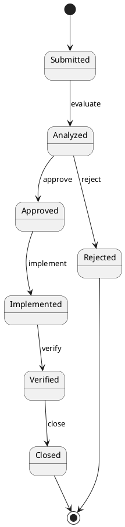

# Change Control

## Revision History

| Version | Date | Description | Author |
| :--- | :--- | :--- | :--- |
| Change control draft | {{date}} | First draft for the current change control process. | {{author}} |
| | | | |

---

## Purpose

<Describe how change requests are recorded, evaluated, approved, and traced to the affected artifacts.>

---

## Change Request Lifecycle

<Describe the states a change request moves through (e.g., Submitted → Analyzed → Approved → Implemented → Verified → Closed).>

---

## Change Request Record

| Field | Description |
| :--- | :--- |
| CR ID | Unique identifier of the change request |
| Title | Short description |
| Requester | Who requested the change |
| Date | Request date |
| Priority | Low / Medium / High |
| Affected Artifacts | Configuration items impacted |
| Status | Current state in the lifecycle |
| Decision | Approve / Reject and rationale |
| Implemented By | Who applied the change |
| Verification | How the change was verified |

---

## Change Log

| CR ID | Title | Affected Artifacts | Date | Status | Decision |
| :--- | :--- | :--- | :--- | :--- | :--- |
| CR-{{#}} | <Title> | <Artifacts> | {{date}} | <Status> | <Decision> |
| CR-{{#}} | <Title> | <Artifacts> | {{date}} | <Status> | <Decision> |

---

## Traceability

<Describe how a change request links back to the requirements, use cases, and design artifacts it modifies.>

---

## Emergency Changes

<Define the accelerated process for urgent production fixes (hotfix) and the post-hoc documentation required.>
